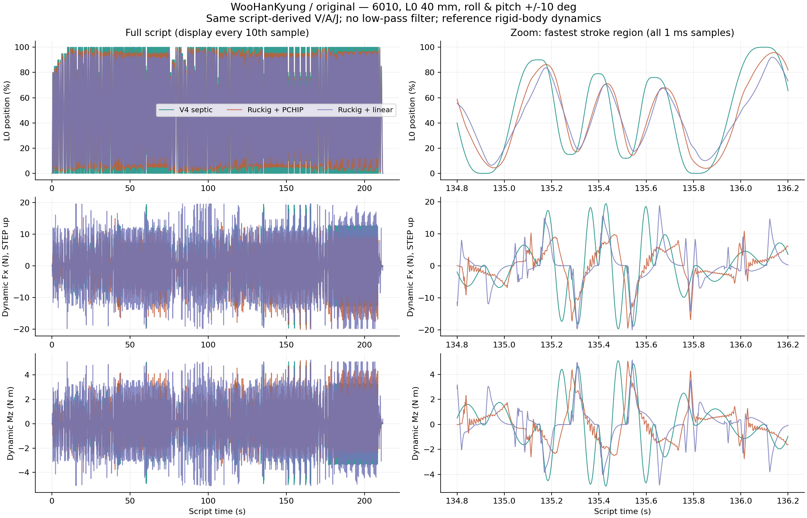
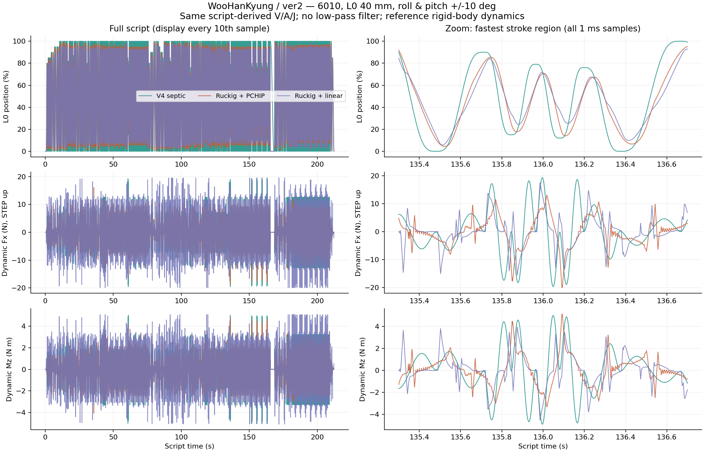

# WooHanKyung：V4 与普通 TCode + Ruckig 离线比较

日期：2026-10-16。结论适用于以下明确的仿真条件，不是实机振动测量。

## 结论

两组脚本都显示：相同脚本推导的 V/A/J 上限下，V4 明显降低底座反作用力的变化率，但动态合力峰值只降低约 2%，动态合力 RMS 反而增加。不能用一个百分比概括为“冲击降低”。

普通播放采用 MFP 默认的 PCHIP 节点插值时：

| 指标 | 原版 Ruckig | 原版 V4 | V4 相对变化 | ver2 Ruckig | ver2 V4 | V4 相对变化 |
|---|---:|---:|---:|---:|---:|---:|
| 动态合力峰值 N | 20.419 | 19.937 | −2.36% | 20.150 | 19.768 | −1.90% |
| 动态合力 RMS N | 3.631 | 4.850 | +33.59% | 3.364 | 4.769 | +41.77% |
| 力变化率 RMS N/s | 397.712 | 169.799 | −57.31% | 403.686 | 164.697 | −59.20% |
| 动态合力矩峰值 N·m | 5.232 | 5.112 | −2.29% | 5.148 | 5.056 | −1.80% |
| 动态合力矩 RMS N·m | 0.927 | 1.245 | +34.34% | 0.867 | 1.222 | +40.90% |
| 力矩变化率 RMS N·m/s | 101.699 | 43.713 | −57.02% | 103.417 | 41.976 | −59.41% |

采用原始节点的线性插值作为普通播放输入时，合力变化率 RMS 降幅约 65.2%–65.7%，合力 RMS 增加约 10.6%–11.6%，峰值降幅仍只有约 1.8%–2.2%。输入插值方式影响数字，所以主结论采用 MFP 默认 PCHIP，并保留线性对照。

V4 是已知未来节点的定时轨迹；普通 Ruckig 在线追踪当前目标。两条路径在相同时间的实际位置并不相同。这个实验比较的是同一脚本、同一限值下的实际参考输出，不是同一条已执行轨迹的机械响应。

## 输入与条件

- 来源：`C:/Users/wangyu/Downloads/WooHanKyung Booty Bounce` 中原版和 ver2 的全部六个 `.funscript` 文件。
- 每组同时联动 L0、R1/roll、R2/pitch；文件没有 L1、L2、R0，缺失轴保持中心。
- 原版长度 211.755 s；ver2 长度 212.322 s。分别完整回放，不拼接两版，不读取视频或压缩包。
- 原始动作不做低通、不去噪、不额外简化、不手动删点。遇到重复/乱序时间或越界位置直接报错，不静默清洗。
- V4 保留现有 MFP 换向点提取规则（1% 阈值）、初始静止段、60 s 分段以及四位位置量化。它是协议本身的处理，不是本轮新加的过滤。
- 6010 CAD 和既有质量/惯量模型，额外负载 0，杆尖补偿关闭。
- 归一化完整范围映射：L0 −20…+20 mm；roll/pitch −10…+10°；倍率 1，脚本幅度 100%，无自动缩幅。脚本实际 roll 只用约 20%…80%，pitch 用约 15%…85%，所以实际角度小于映射范围。
- 起点已定位，初始速度/加速度为零；不计启动定位过程。统计从脚本 0 时刻到末尾，不包含额外尾部停稳时间。
- 普通路径：每 10 ms 采样输入，四位 TCode 位置，dirty-only 判定，`I10`，无丢包/延迟/抖动。默认 PCHIP 按本机 MFP 的 `KeyframeCollection` 与 `MathUtils.Pchip` 移植，另跑线性输入对照。
- **Ruckig 离线控制步长为 1 ms（1000 Hz），这是本轮数值实验参数，不是已读取的设备运行设置。固件出厂代码默认控制频率为 100 Hz，当前设备实际频率未读取。** 不应把本报告当作未知设备设置的逐帧复现。
- 使用真实固件 `TCodeTrajectorySmoother` 和 `components/ruckig_float/tcode_ruckig.cpp` 重新编译的主机后端，六轴 Time 同步、目标速度/加速度为零，保留生产 fallback。
- V4 使用与固件相同的七次多项式解析状态，采用双精度计算动力学参考；不模拟传输时钟误差及 MCU 浮点的逐位误差。
- 两者随后进入相同 CAD IK 和刚体惯性计算；未模拟电机伺服误差、MIT 后级限制、机架弹性、间隙或接触碰撞。没有运行设备、刷写或修改设备配置。

## 从脚本计算共同限值

对 V4 每段量化后的归一化位移 D、实时时长 T，解析求峰值：

`V = 2.1875 |D| / T`

`A = 7.513188404399293 |D| / T²`

`J = 52.5 |D| / T³`

分别汇总平移组和旋转组。两版算出的最大需求相同：

| 轴/组 | 所需 V（s⁻¹） | 所需 A（s⁻²） | 所需 J（s⁻³） |
|---|---:|---:|---:|
| L0 / 平移组 | 12.524840 | 367.673673 | 21958.956377 |
| R1 / roll | 7.498750 | 147.172628 | 5876.571429 |
| R2 / pitch | 7.166843 | 139.069168 | 5490.256225 |
| 旋转组共同需求 | 7.498750 | 147.172628 | 5876.571429 |

为覆盖 MFP 两个位置计数的幅度余量与量化误差，每段以 `|D| + 0.0003` 再乘 1.01 计算共同上限。实际用于两条路径的参数是：

| 组 | V | A | J |
|---|---:|---:|---:|
| 平移 | 12.655753 | 371.516711 | 22188.478115 |
| 旋转 | 7.577525 | 148.718689 | 5938.305306 |

这组数值是满足当前 V4 脚本的需求，不是硬件能力评估。L0 按 40 mm 映射，所需峰值约为 0.501 m/s、14.707 m/s²、878.358 m/s³。

最大需求的代表段：

| 版本 | 轴 | 开始 s | 结束 s | 位移占完整轴范围 | 时长 ms |
|---|---|---:|---:|---:|---:|
| 原版 | L0 | 135.397 | 135.514 | 66.99% | 117 |
| ver2 | L0 | 135.964 | 136.081 | 66.99% | 117 |
| 原版 | roll | 61.686 | 61.861 | 59.99% | 175 |
| ver2 | roll | 62.208 | 62.383 | 59.99% | 175 |
| 原版 | pitch | 22.837 | 23.014 | 57.99% | 177 |
| ver2 | pitch | 23.359 | 23.536 | 57.99% | 177 |

不同段有相同最大值；完整记录见输入 manifest。

| 版本 | L0 原始→V4 节点 | roll 原始→V4 节点 | pitch 原始→V4 节点 |
|---|---:|---:|---:|
| 原版 | 815→814 | 613→610 | 899→898 |
| ver2 | 802→800 | 603→600 | 884→882 |

## 跟随差异

在 V4 中间节点规定的时刻，对普通 PCHIP + Ruckig 的位置偏差取绝对值并求平均，单位为完整轴范围的百分比（百分点）：

| 版本 | L0 平均偏差 | roll 平均偏差 | pitch 平均偏差 |
|---|---:|---:|---:|
| 原版 | 8.58% | 3.22% | 2.67% |
| ver2 | 10.44% | 3.09% | 2.50% |

V4 在这些规定时刻解析到达量化后的节点，误差为零。普通路径的偏差同时含滞后和行程未完成，不能全部解释成幅度损失；全片最大最小值也不能代表每一拍的行程保持率。

因此，V4 的力 RMS 更高与它更完整、按时完成动作相伴。不能据此认定其平滑性更差，也不能把力变化率下降等同于实机振幅下降。

## 指标与数值验证

- 力/力矩是机构运动部分施加给固定底座的**惯性反作用**，按每个姿态分离并排除重力项。包含部件线性惯性、角加速度与陀螺项。
- 原点为 6010 固定底板质心；坐标采用源 STEP 坐标，+X 向上。它与 UI 的运动轴命名不同。原点坐标在 JSON 中。
- 合力为 `sqrt(Fx²+Fy²+Fz²)`；合力矩同理。RMS 是整段均方根。
- 力变化率为相邻 **1 ms** 采样的力矢量差除以 0.001 s，再计算矢量范数 RMS；不是 `d|F|/dt`，也不是冲量积分。
- 动力学不对量化位置连续差分来估计速度。使用 Ruckig 输出的 p/v/a，以及 V4 解析 p/v/a，构造局部二次位姿，通过五点运动学微分得到各刚体加速度。这样避免把浮点位置量化噪声误当成加速度；没有低通滤波。
- 最终动力学采样 1 ms，局部微分步长 0.05 ms。初轮用 2 ms / 0.1 ms：合力/合力矩 RMS 差异不超过约 0.013%，峰值差异不超过约 0.52%。力变化率对采样更敏感，Ruckig 约差 3.2%，最终报告固定采用 1 ms 定义。
- 四次 Ruckig 回放均无 rejected、errors 或 fallback_errors；仅原版线性输入有一次成功 fallback。PCHIP 两版无 fallback。
- 每次动力学求值检查 IK 可达性；全部采样通过。这里的可达性不等于整机碰撞检测。

## 曲线和数据

全片图只为显示抽取每第十个采样点，放大图显示全部 1 ms 点；统计始终用完整采样。

- [PCHIP 主结果，含六分量与统计](data/woohan-pchip-comparison.json)
- [线性输入对照](data/woohan-linear-comparison.json)
- [输入文件校验值、节点统计和限值来源](data/woohan-input-manifest.json)
- 完整 CSV 和二进制回放位于 `work/script-comparison/` 与 `work/script-comparison-pchip/`。

复现：在本项目 PowerShell 中运行 `./scripts/run-script-comparison.ps1`。使用已有 Conda base 环境和 g++，无需安装依赖。脚本重新构建相邻固件工程的生产主机后端，再分别运行两种输入与绘图；不访问串口。

实现来源：固件 `src/executor/tcode_stream.cpp`、`include/tcode_queue.hpp`、`include/tcode_trajectory_smoother.hpp`、`components/ruckig_float/tcode_ruckig.cpp`；MFP `OutputTarget/TCodeBuffered/TCodeBufferedPlan.cs`、`OutputTarget/ViewModels/SerialOutputTarget.cs`、`Common/KeyframeCollection.cs`、`Common/Utils/MathUtils.cs`。主机后端构建签名为 `fae0d83a60b88b37ee2d28bdfcc0bc0bb48162d576e04436a1d8bb1cc5050b92`。
